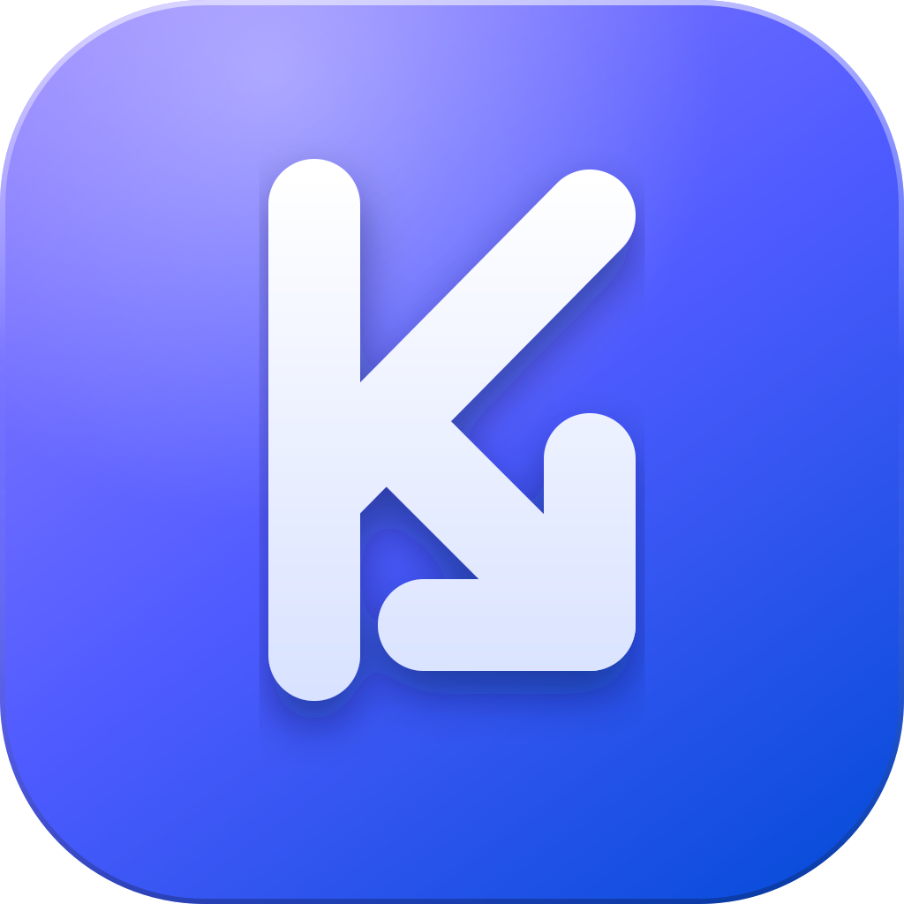

<p align="center">
  
</p>

<h1 align="center">Katevazo</h1>

<p align="center">
  A clean, fast, cross-platform video downloader for Windows, macOS and Linux.<br />
  Built with Rust, Tauri 2 and React. Powered by <a href="https://github.com/yt-dlp/yt-dlp">yt-dlp</a> and <a href="https://ffmpeg.org">ffmpeg</a>.
</p>

<p align="center">
  <a href="https://github.com/ipuppyyt/katevazo/actions/workflows/ci.yml"></a>
  <a href="LICENSE"></a>
  
</p>

> *Katevazo* comes from the Greek κατέβασε, "download".

## Features

- Paste a link, preview the title, thumbnail and available qualities, then download as video (MP4) or audio (MP3)
- Pause, resume, cancel and retry any download at any time; partial files are continued, not restarted
- A queue that runs several downloads at once, with live progress, speed and time remaining
- A single, steady progress bar even when video and audio are fetched as separate streams
- Download history, a configurable save folder, and light, dark or system appearance
- One-click yt-dlp updates from inside the app, so downloads keep working when sites change
- A native-feeling Apple-style interface that follows each platform's window conventions
- Small installers and low memory use, thanks to Tauri (no bundled browser)

## Status

Katevazo is in early development (pre-1.0). Expect rough edges, and please
[report them](https://github.com/ipuppyyt/katevazo/issues/new/choose).
Only YouTube has been tested so far; yt-dlp supports many more sites, and they may
work too.

## Install

Pre-built installers will be published on the
[Releases](https://github.com/ipuppyyt/katevazo/releases) page once the first version
is tagged. Until then, [build it from source](#build-from-source).

## Build from source

### Prerequisites

- [Node.js](https://nodejs.org) 22 or newer
- [Rust](https://rustup.rs) (stable)
- The [Tauri 2 system dependencies](https://tauri.app/start/prerequisites/) for your OS
  (on Linux: `libwebkit2gtk-4.1-dev`, `libappindicator3-dev`, `librsvg2-dev`, `patchelf`)

### Run

```bash
git clone https://github.com/ipuppyyt/katevazo.git
cd katevazo
npm install
npm run sidecars   # downloads yt-dlp, ffmpeg, ffprobe and Deno for your platform
npm run tauri dev
```

### Package an installer

```bash
npm run tauri build
```

### Test

```bash
npm run build                      # type-check and build the frontend
cd src-tauri && cargo test         # Rust unit tests
```

## How it works

Katevazo does not reimplement extraction. It runs `yt-dlp` and `ffmpeg` as bundled
sidecar programs and talks to them from Rust:

```
React UI  <-- Tauri commands and events -->  Rust core
                                              ├─ download queue (pause / resume / cancel)
                                              ├─ yt-dlp wrapper (metadata, progress parsing)
                                              ├─ settings (JSON) and history (SQLite)
                                              └─ ffmpeg (merge video + audio, convert to MP3)
```

Pausing stops the yt-dlp process and keeps the partial file; resuming starts it again
and yt-dlp continues from where it stopped. See [CONTRIBUTING.md](CONTRIBUTING.md) for
a tour of the code.

## Roadmap

- [ ] In-app auto-update for Katevazo itself
- [ ] Playlist and batch downloads
- [ ] Subtitle, format and filename-template options
- [ ] Installers for Windows ARM and Intel macOS
- [ ] Code signing and notarization

## Contributing

Contributions are welcome. Please read [CONTRIBUTING.md](CONTRIBUTING.md) and the
[Code of Conduct](CODE_OF_CONDUCT.md) first. To report a security issue, see
[SECURITY.md](SECURITY.md).

## Legal

Katevazo is a tool; you are responsible for how you use it. Only download content you
have the right to download, and respect the terms of service of the sites you use and
the copyright laws that apply to you. The authors do not endorse or encourage
infringement.

Katevazo is released under the [MIT License](LICENSE). It bundles or depends on
third-party software under other licenses; see
[THIRD_PARTY_NOTICES.md](THIRD_PARTY_NOTICES.md).
